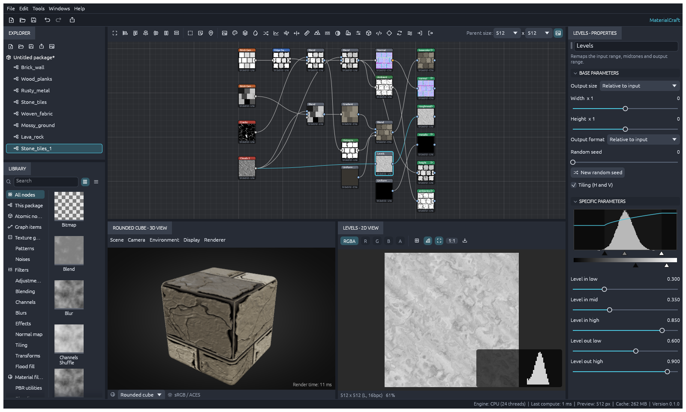

# The Levels editor

The **Levels** node remaps its input: it stretches the input range (*Level in low* to *Level in
high*), bends the midtones (*Level in mid*) and squeezes the result into the output range (*Level
out low* to *Level out high*). Select a Levels node and the **Specific parameters** section of the
properties panel shows a visual editor above the usual sliders. This is a clean-room
implementation.

<p align="center">
  
  <br><sub>The Levels editor: the input histogram, the transfer curve and the handles</sub>
</p>

## What it shows

- **The input histogram**: how many pixels of the image feeding the node have each value, in
  256 bins over 0..1. A grayscale input shows one gray histogram; a color input shows red, green
  and blue on top of each other. Values outside 0..1 count in the end bins. The bar heights scale
  to the tallest bin *between* pure black and pure white, because masks pile up at the ends and
  would flatten everything else. Without an input wire the editor says so.
- **The clipped areas**: the parts of the histogram outside the input range are darkened. Those
  values all become the output low or high.
- **The transfer curve** (accent line): the output value for every input value, so the effect
  of all five parameters can be read at a glance.

The histogram is computed once per cooked result of the input and reused until that result
changes.

## Handles

| Handle | Row | Parameter | Behavior |
|---|---|---|---|
| Black triangle | under the histogram | *Level in low* | Cannot pass the high handle |
| Gray triangle | under the histogram | *Level in mid* | Sits where the midtone acts: `in low + in mid × (in high − in low)`. It moves with the low and high handles and stays strictly inside the range (stored as 0.01..0.99) |
| White triangle | under the histogram | *Level in high* | Cannot pass the low handle |
| Black triangle | under the gradient bar | *Level out low* | Free |
| White triangle | under the gradient bar | *Level out high* | Free; dragging it left of the low handle inverts the output |

- Hovering a handle highlights it and shows its parameter and value.
- Dragging a handle sets its parameter live. One drag is one undo step.
- A parameter bound to a graph input or driven by a function shows its handle but cannot be
  dragged; edit it where it is driven.
- The sliders below still give exact values and the right-click menu (reset, expose, bind,
  function).

## What changed in the node

- *Level in mid* was always relative to the input range (0.5 = linear), but the only editor was
  an absolute 0..1 slider, so its position meant nothing next to *Level in low* and *Level in
  high*. The gray handle now shows where it really acts.
- Dragging the input low handle past the high one used to flip the remap without warning. The
  editor keeps them apart. The sliders and commands still accept any values, so existing files
  cook exactly as before.
- `levels_fn` no longer lets a NaN (from an input or a hostile parameter) spread through the
  graph: it is treated as 0.

## For agents and scripts

The editor only sets the node's existing parameters, so there is nothing new to drive:

```json
{"id": 1, "method": "command.run", "params": {"id": "graph.node.param", "params": {"id": 42, "param": "in_mid", "value": 0.35}}}
```

`session.inspect` reports the parameters and the input's cooked `mean`; the 2D view's histogram
(`view.2d {"histogram": true}`) shows the node's output.

## Implementation and tests

- `crates/ui-egui/src/levels_editor.rs`: `histogram`, `values`, `mid_position`, `drag_value`
  (the handle constraints) and the drawing; called from `properties.rs` for `levels` nodes.
- `crates/nodes/src/atomic.rs`: the NaN guard in `levels_fn`.
- Tests: `levels_editor::tests` (histogram counts, end bins and NaN; handle constraints and the
  relative mid), `atomic::levels_tests` (identity, stretch and clip, the relative mid, output
  range and inversion, threshold, NaN), and the `levels-editor` scene of the `snapshots` UI test,
  which renders the screenshot above.
